# CHPL React Component Tree

## Overview
This document maps the entire CHPL app's component hierarchy, provider stack, page structure, and shared components. It serves as a visual guide for understanding how the application is structured and how data flows through the system.

---

## 1. Provider & Wrapper Hierarchy

The app is wrapped in multiple context providers and wrappers that handle cross-cutting concerns. This stack is initialized in `AppWrapper` and mounted at the root.

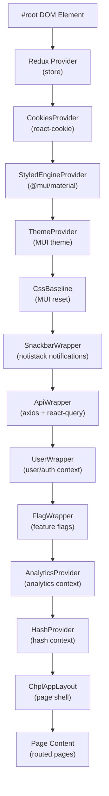

**Key Details:**
- **Redux Store** persists 3 slices to `localStorage`: `browserInfo`, `userInfo`, `widget`
- **ApiWrapper** configures the shared `QueryClient` for `react-query` hooks
- **UserWrapper** manages authentication state
- **FlagWrapper** evaluates feature flags per user
- **AnalyticsProvider & HashProvider** handle app-wide cross-cutting data
- **ChplAppLayout** provides the layout shell (top nav, content, widget rail)

---

## 2. App Layout Structure

The main layout container that wraps all pages. Located at `src/app/app-layout.jsx` and mounted by `AppWrapper`.

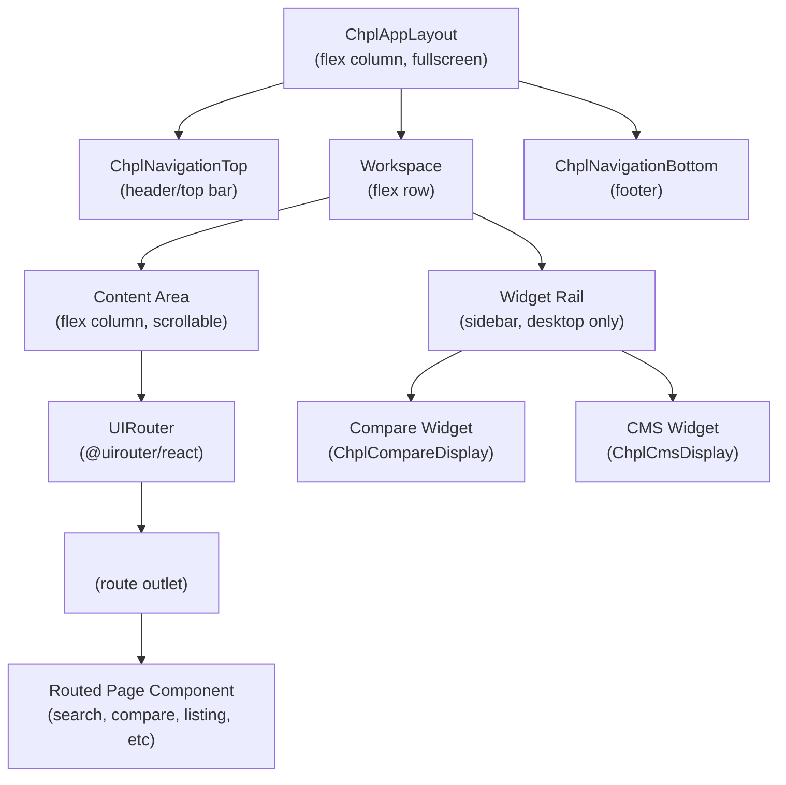

**Key Components:**
- **NavTop**: Main navigation, search bar integration
- **MainContent**: Scrollable area for page content
- **WidgetRail**: Right sidebar (desktop only) with compare & CMS lookup widgets
- **UIRouter/UIView**: Route rendering system (hash-based routing via `@uirouter/react`)

---

## 3. Page Structure (by Area)

The app is organized into major feature areas under `src/app/pages/`. Each area may contain multiple sub-pages or routes.

```mermaid
graph TD
    Pages["Pages Directory<br/>(src/app/pages)"]
    
    Pages --> Search["Search Area"]
    Pages --> Compare["Compare"]
    Pages --> Listing["Listing Details"]
    Pages --> Administration["Administration"]
    Pages --> Organizations["Organizations"]
    Pages --> Users["Users Management"]
    Pages --> Reports["Reports"]
    Pages --> Surveillance["Surveillance"]
    Pages --> Registration["Registration"]
    Pages --> Resources["Resources & Help"]
    Pages --> Compliance["Compliance Dashboard"]
    Pages --> Charts["Analytics Charts"]
    Pages --> Other["Subscriptions, Component Usage, etc"]
    
    Search --> SearchPage["ChplSearchPage"]
    Search --> SearchFilters["Filter Panel, Results"]
    Search --> RWT["Real World Testing"]
    
    Listing --> ListingDetail["ListingDetail Page"]
    Listing --> ListingTabs["Tabs: History, Activity, etc"]
    
    Compare --> ComparePage["ChplComparePage"]
    
    Administration --> AdminLogin["Login"]
    Administration --> AdminInvite["Invite Users"]
    Administration --> AdminReports["Admin Reports"]
    
    Organizations --> OrgList["Organization List"]
    Organizations --> OrgDetail["Organization Detail"]
    
    Reports --> ReportsList["Reports List/Grid"]
    Reports --> Activity["Activity Reports"]
    Reports --> DownloadListings["Download Listings"]
```

---

## 4. Shared Components & Utilities (Detailed)

Reusable components and utilities located in `src/app/components/`. These are used across multiple pages.

### 4.1 High-Level Organization

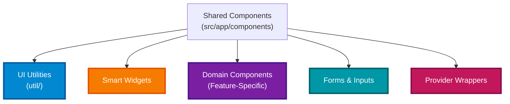

### 4.2 UI Utilities (src/app/components/util/)

The foundation layer — pure presentation components used everywhere.

```mermaid
graph TD
    Util["UI Utilities<br/>(util/ directory)"]
    
    Util --> Typography["Typography & Layout"]
    Util --> Display["Data Display"]
    Util --> Interaction["Interaction & Input"]
    Util --> Loading["Loading States"]
    Util --> Feedback["Feedback & Messaging"]
    
    Typography --> Header["ChplPageHeader<br/>(page title bar)"]
    Typography --> Body["ChplPageBody<br/>(content wrapper)"]
    Typography --> Breadcrumb["ChplBreadcrumbs<br/>(navigation trail)"]
    
    Display --> Table["ChplTable<br/>(data table with sorting)"]
    Display --> Card["ChplCard<br/>(MUI Card wrapper)"]
    Display --> Badge["ChplBadge<br/>(status badges)"]
    Display --> Chip["ChplChip<br/>(tag/token)"]
    Display --> Tag["Styled Tags & Labels"]
    
    Interaction --> Button["ChplButton<br/>(primary/secondary)"]
    Interaction --> Link["ChplLink<br/>(internal navigation)"]
    Interaction --> Modal["ChplModal<br/>(dialog/popup)"]
    Interaction --> Tooltip["ChplTooltip<br/>(hover text)"]
    Interaction --> Dropdown["Dropdown Menus"]
    
    Loading --> Skeleton["ChplSkeleton<br/>(animated placeholder)"]
    Loading --> SkeletonPage["ChplLoadingPage<br/>(full page skeleton)"]
    Loading --> SkeletonCard["ChplSkeletonCard<br/>(card-shaped skeleton)"]
    Loading --> SkeletonCards["ChplLoadingCards<br/>(multiple skeletons)"]
    Loading --> ResultsUpdating["ChplResultsUpdating<br/>(dimming overlay during refresh)"]
    
    Feedback --> Snackbar["SnackbarWrapper<br/>(toast notifications)"]
    Feedback --> Alert["ChplAlert<br/>(dismissible alert)"]
    Feedback --> Error["Error Messages<br/>(validation, API errors)"]
    
    style Typography fill:#0288d1,color:#fff,stroke:#01579b,stroke-width:2px
    style Display fill:#00897b,color:#fff,stroke:#004d40,stroke-width:2px
    style Interaction fill:#f57c00,color:#fff,stroke:#e65100,stroke-width:2px
    style Loading fill:#d32f2f,color:#fff,stroke:#b71c1c,stroke-width:2px
    style Feedback fill:#6a1b9a,color:#fff,stroke:#4a148c,stroke-width:2px
```

### 4.3 Smart Widgets (Persist to Redux, Handle Interactivity)

```mermaid
graph TD
    Widgets["Smart Widgets<br/>(Store state to Redux)"]
    
    Widgets --> CompareWidget["Compare Widget<br/>(compare-widget/)"]
    Widgets --> CmsWidget["CMS ID Widget<br/>(cms-widget/)"]
    Widgets --> BrowserWidget["Browser Widget<br/>(browser/)"]
    Widgets --> ActionWidget["Action Widget<br/>(action-widget/)"]
    
    CompareWidget --> CompareDisplay["ChplCompareDisplay<br/>(renders in widget rail)"]
    CompareWidget --> CompareLogic["Compare Listing Logic<br/>(add, remove, clear)"]
    CompareWidget --> CompareState["State: browserInfo.compare<br/>(persisted to localStorage)"]
    
    CmsWidget --> CmsDisplay["ChplCmsDisplay<br/>(renders in widget rail)"]
    CmsWidget --> CmsInput["CMS Input Form<br/>(lookup by CHPL #)"]
    CmsWidget --> CmsState["State: browserInfo.cmsLookupIds<br/>(persisted)"]
    
    BrowserWidget --> PrevViewed["Previously Viewed<br/>(quick access)"]
    BrowserWidget --> Favorites["Favorites<br/>(saved listings)"]
    BrowserWidget --> BrowserState["State: browserInfo slice<br/>(all persisted)"]
    
    ActionWidget --> SaveBtn["Save/Submit Button<br/>(dispatch actions)"]
    ActionWidget --> CancelBtn["Cancel/Reset Button"]
    ActionWidget --> ActionState["State: actionBar slice<br/>(NOT persisted)"]
    
    style CompareWidget fill:#f57c00,color:#fff,stroke:#e65100,stroke-width:2px
    style CmsWidget fill:#f57c00,color:#fff,stroke:#e65100,stroke-width:2px
    style BrowserWidget fill:#f57c00,color:#fff,stroke:#e65100,stroke-width:2px
    style ActionWidget fill:#f57c00,color:#fff,stroke:#e65100,stroke-width:2px
```

### 4.4 Domain-Specific Components (Feature Areas)

Components tied to specific features/domains. Reused within that domain, sometimes across domains.

```mermaid
graph TD
    Domain["Domain Components<br/>(Feature-Specific)"]
    
    Domain --> Search["Search Domain"]
    Domain --> Listing["Listing Domain"]
    Domain --> Developer["Developer Domain"]
    Domain --> ACB["ACB/Certifying Body Domain"]
    Domain --> Changes["Change Request Domain"]
    Domain --> Surveillance["Surveillance Domain"]
    Domain --> Activity["Activity/History Domain"]
    
    Search --> FilterPanel["ChplFilterPanel<br/>(advanced filters)"]
    Search --> SearchControls["ChplSortControls<br/>(sort, pagination)"]
    Search --> ResultsTable["Results Display<br/>(custom table)"]
    
    Listing --> DetailHeader["Listing Header<br/>(title, status)"]
    Listing --> DetailTabs["Tab Navigation<br/>(History, Activity, etc)"]
    Listing --> DetailContent["Detail Content<br/>(specs, certs, etc)"]
    Listing --> EditForm["Listing Edit Form<br/>(edit mode)"]
    
    Developer --> DevCard["Developer Card<br/>(summary view)"]
    Developer --> DevDetail["Developer Detail<br/>(full profile)"]
    Developer --> DevForm["Developer Form<br/>(create/edit)"]
    
    ACB --> AcbCard["ACB Card<br/>(summary)"]
    ACB --> AcbDetail["ACB Detail Page"]
    ACB --> AcbForm["ACB Form<br/>(create/edit)"]
    
    Changes --> ChangeForm["Change Request Form<br/>(submit changes)"]
    Changes --> ChangeHistory["Change History<br/>(view past changes)"]
    Changes --> ChangeDetail["Change Detail Page"]
    
    Surveillance --> ComplaintForm["Complaint Form<br/>(file complaint)"]
    Surveillance --> NonconformityForm["Non-Conformity Form<br/>(track issues)"]
    Surveillance --> SurveillanceDetail["Surveillance Detail"]
    
    Activity --> ActivityLog["Activity Log<br/>(timestamped events)"]
    Activity --> ActivityReport["Activity Report<br/>(aggregated view)"]
    Activity --> HistoryCompare["History Compare<br/>(before/after)"]
    
    style Search fill:#0288d1,color:#fff,stroke:#01579b,stroke-width:2px
    style Listing fill:#7b1fa2,color:#fff,stroke:#4a148c,stroke-width:2px
    style Developer fill:#00897b,color:#fff,stroke:#004d40,stroke-width:2px
    style ACB fill:#c2185b,color:#fff,stroke:#880e4f,stroke-width:2px
    style Changes fill:#f57c00,color:#fff,stroke:#e65100,stroke-width:2px
    style Surveillance fill:#1565c0,color:#fff,stroke:#0d47a1,stroke-width:2px
    style Activity fill:#558b2f,color:#fff,stroke:#33691e,stroke-width:2px
```

### 4.5 Form Components & Input Groups

```mermaid
graph TD
    Forms["Form Components<br/>(forms, inputs, validation)"]
    
    Forms --> TextInputs["Text Inputs"]
    Forms --> Selects["Selects & Dropdowns"]
    Forms --> Checkboxes["Checkboxes & Radios"]
    Forms --> Dates["Date Pickers"]
    Forms --> Validation["Validation & Errors"]
    Forms --> FormLayout["Form Layout"]
    
    TextInputs --> TextField["ChplTextField<br/>(single-line, with validation)"]
    TextInputs --> TextArea["ChplTextArea<br/>(multi-line)"]
    TextInputs --> NumberInput["Number Input<br/>(with constraints)"]
    
    Selects --> Select["ChplSelect<br/>(dropdown list)"]
    Selects --> Autocomplete["ChplAutocomplete<br/>(searchable dropdown)"]
    Selects --> MultiSelect["Multi-Select<br/>(checkboxes or tags)"]
    
    Checkboxes --> Check["ChplCheckbox<br/>(single checkbox)"]
    Checkboxes --> Radio["ChplRadio<br/>(radio group)"]
    Checkboxes --> Toggle["Toggle Switch<br/>(on/off)"]
    
    Dates --> DatePicker["Date Picker<br/>(calendar widget)"]
    Dates --> DateRange["Date Range Picker<br/>(from/to)"]
    
    Validation --> ErrorMsg["Error Message Display<br/>(field-level)"]
    Validation --> FormError["Form Error Summary<br/>(all errors)"]
    Validation --> FieldHint["Field Hint Text<br/>(help info)"]
    
    FormLayout --> Group["ChplFormGroup<br/>(label + input + error)"]
    FormLayout --> Section["ChplFormSection<br/>(grouped fields)"]
    FormLayout --> ButtonGroup["Button Group<br/>(submit, cancel, etc)"]
    
    style TextInputs fill:#0097a7,color:#fff,stroke:#006064,stroke-width:2px
    style Selects fill:#0097a7,color:#fff,stroke:#006064,stroke-width:2px
    style Checkboxes fill:#0097a7,color:#fff,stroke:#006064,stroke-width:2px
    style Dates fill:#0097a7,color:#fff,stroke:#006064,stroke-width:2px
    style Validation fill:#d32f2f,color:#fff,stroke:#b71c1c,stroke-width:2px
    style FormLayout fill:#558b2f,color:#fff,stroke:#33691e,stroke-width:2px
```

### 4.6 Component Usage Frequency (Dependencies)

Which components are used most across the app:

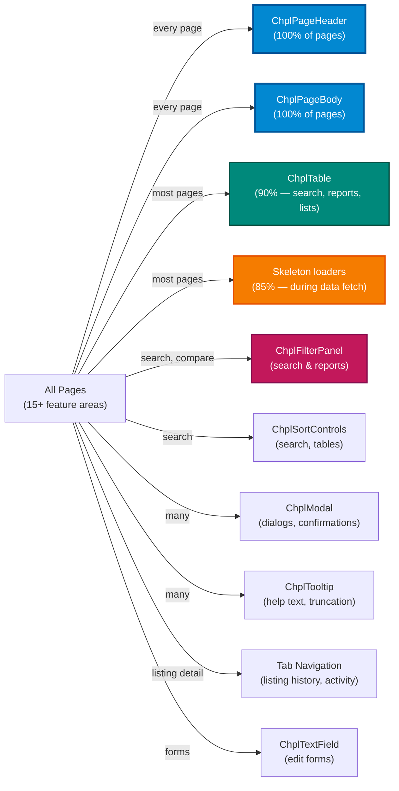

### 4.7 Component Dependency Graph (What Imports What)

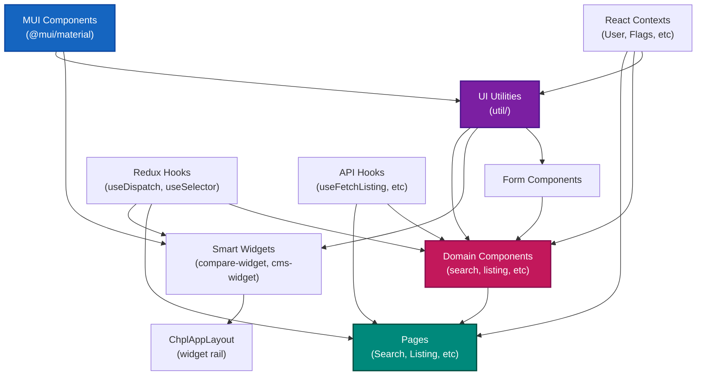

**Key Component Patterns:**
- **Page component** (`x.jsx`): Container, fetches data, holds state
- **View component** (`x-view.jsx`): Presentational, receives props
- **Page wrapper** (`x-page.jsx`): Adds page frame when component is embedded elsewhere
- **Loading skeleton** (`ChplXLoading`): Defined in same file as page component
- **Domain providers** (`x-wrapper.jsx`): Real providers (`AppWrapper`, `ApiWrapper`, `UserWrapper`, etc.)

### 4.8 Component Lifecycle & Data Flow Example

Here's how a typical component hierarchy works (using the Search page as example):

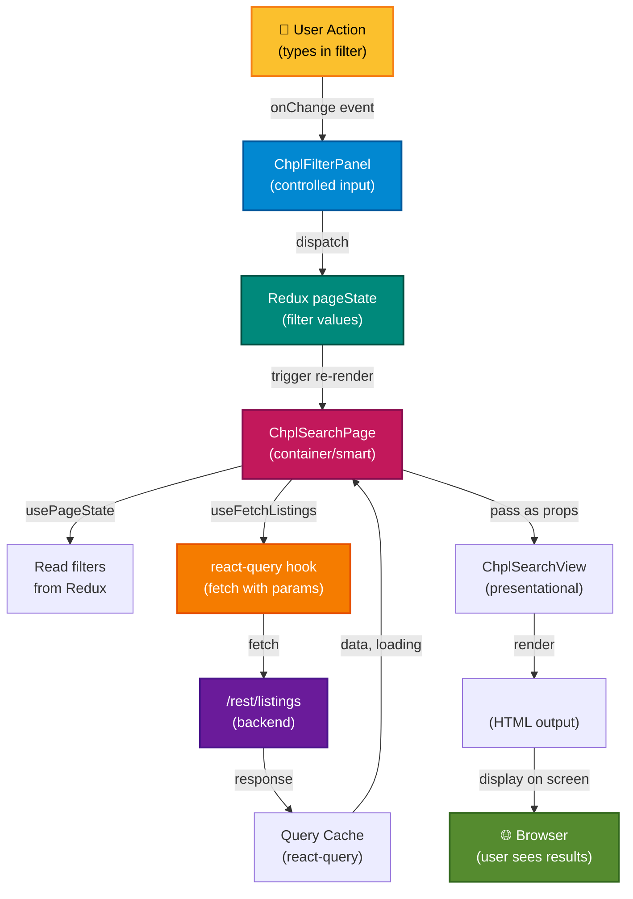

### 4.9 All UI Utility Components (Complete List)

```mermaid
graph TD
    Util["UI Utility Components<br/>(src/app/components/util/)"]
    
    Util --> PageFrame["Page Frame"]
    Util --> Display["Data Display"]
    Util --> Controls["Controls & Buttons"]
    Util --> Navigation["Navigation"]
    Util --> Forms["Form Elements"]
    Util --> Loading["Loading & Skeleton"]
    Util --> Modals["Modals & Overlays"]
    Util --> Info["Info & Feedback"]
    
    PageFrame --> PageHeader["ChplPageHeader<br/>(title, layout)"]
    PageFrame --> PageBody["ChplPageBody<br/>(content wrapper)"]
    PageFrame --> Container["Container<br/>(responsive width)"]
    
    Display --> Table["ChplTable<br/>(sortable data table)"]
    Display --> Card["ChplCard<br/>(MUI Card)"]
    Display --> List["ChplList<br/>(vertical list)"]
    Display --> Badge["ChplBadge<br/>(colored status)"]
    Display --> Chip["ChplChip<br/>(tag/pill)"]
    Display --> Avatar["ChplAvatar<br/>(profile picture)"]
    Display --> Divider["ChplDivider<br/>(visual separator)"]
    Display --> Spacer["Spacer<br/>(fixed spacing)"]
    
    Controls --> Button["ChplButton<br/>(primary/secondary/tertiary)"]
    Controls --> IconBtn["ChplIconButton<br/>(icon-only)"]
    Controls --> FAB["ChplFAB<br/>(floating action)"]
    Controls --> ToggleBtn["Toggle Button<br/>(on/off state)"]
    
    Navigation --> Link["ChplLink<br/>(internal router link)"]
    Navigation --> Breadcrumb["ChplBreadcrumbs<br/>(nav trail)"]
    Navigation --> Tabs["ChplTabs<br/>(tab navigation)"]
    Navigation --> Stepper["ChplStepper<br/>(step indicator)"]
    
    Forms --> Input["ChplTextField<br/>(text input)"]
    Forms --> Select["ChplSelect<br/>(dropdown)"]
    Forms --> Autocomplete["ChplAutocomplete<br/>(searchable)"]
    Forms --> Check["ChplCheckbox<br/>(checkbox)"]
    Forms --> Radio["ChplRadio<br/>(radio group)"]
    Forms --> Switch["ChplSwitch<br/>(toggle)"]
    Forms --> DatePicker["DatePicker<br/>(calendar)"]
    Forms --> Slider["ChplSlider<br/>(range control)"]
    
    Loading --> Skeleton["ChplSkeleton<br/>(animated placeholder)"]
    Loading --> SkeletonPage["ChplLoadingPage<br/>(full page skeleton)"]
    Loading --> SkeletonCard["ChplSkeletonCard<br/>(card skeleton)"]
    Loading --> SkeletonCards["ChplLoadingCards<br/>(grid skeleton)"]
    Loading --> Progress["ChplProgress<br/>(progress bar)"]
    Loading --> Spinner["ChplSpinner<br/>(loading spinner)"]
    Loading --> Dimmer["ChplResultsUpdating<br/>(dim + 'loading' overlay)"]
    
    Modals --> Modal["ChplModal<br/>(dialog popup)"]
    Modals --> Drawer["ChplDrawer<br/>(side panel)"]
    Modals --> Menu["ChplMenu<br/>(dropdown menu)"]
    Modals --> Popover["ChplPopover<br/>(floating content)"]
    
    Info --> Alert["ChplAlert<br/>(dismissible message)"]
    Info --> Tooltip["ChplTooltip<br/>(hover text)"]
    Info --> Snackbar["ChplSnackbar<br/>(toast notification)"]
    Info --> Help["Help Text<br/>(field hints)"]
    Info --> Error["Error Message<br/>(validation error)"]
    
    style PageFrame fill:#bbdefb
    style Display fill:#c8e6c9
    style Controls fill:#ffe0b2
    style Navigation fill:#f8bbd0
    style Forms fill:#e1bee7
    style Loading fill:#ffccbc
    style Modals fill:#f0f4c3
    style Info fill:#d1c4e9
```

### 4.10 Smart Components (Store-Connected)

Components that connect directly to Redux or manage complex interactive state:

```mermaid
graph TD
    Smart["Smart/Connected Components<br/>(Store-Aware)"]
    
    Smart --> Filter["ChplFilterPanel<br/>(dispatch pageState)"]
    Smart --> Sort["ChplSortControls<br/>(dispatch pageState)"]
    Smart --> Compare["Compare Widget<br/>(dispatch browserInfo)"]
    Smart --> Cms["CMS Widget<br/>(dispatch browserInfo)"]
    Smart --> ActionBar["Action Bar<br/>(dispatch actionBar)"]
    Smart --> PageState["Page State Widget<br/>(dispatch pageState)"]
    
    Filter -->|reads| FilterState["pageState.filterKey"]
    Filter -->|writes| FilterAction["setPageState({ key, value })"]
    
    Sort -->|reads| SortState["pageState.sortKey<br/>pageState.pageNum<br/>pageState.pageSize"]
    Sort -->|writes| SortAction["setPageState (3 actions)"]
    
    Compare -->|reads| CompareData["browserInfo.compare<br/>(list of listings)"]
    Compare -->|writes| CompareActions["addCompareListing<br/>removeCompareListing<br/>clearCompare"]
    
    Cms -->|reads| CmsData["browserInfo.cmsLookupIds<br/>(list of CHPL IDs)"]
    Cms -->|writes| CmsAction["addCmsLookupId<br/>removeCmsLookupId"]
    
    ActionBar -->|reads| ActionData["actionBar.canSave<br/>actionBar.isSaving"]
    ActionBar -->|writes| ActionActions["setActionBar({ ... })"]
    
    style Filter fill:#0288d1,color:#fff,stroke:#01579b,stroke-width:2px
    style Sort fill:#0288d1,color:#fff,stroke:#01579b,stroke-width:2px
    style Compare fill:#f57c00,color:#fff,stroke:#e65100,stroke-width:2px
    style Cms fill:#f57c00,color:#fff,stroke:#e65100,stroke-width:2px
    style ActionBar fill:#00897b,color:#fff,stroke:#004d40,stroke-width:2px
    style PageState fill:#00897b,color:#fff,stroke:#004d40,stroke-width:2px
```

### 4.11 Component Props & Configuration Pattern

How props typically flow in this app:

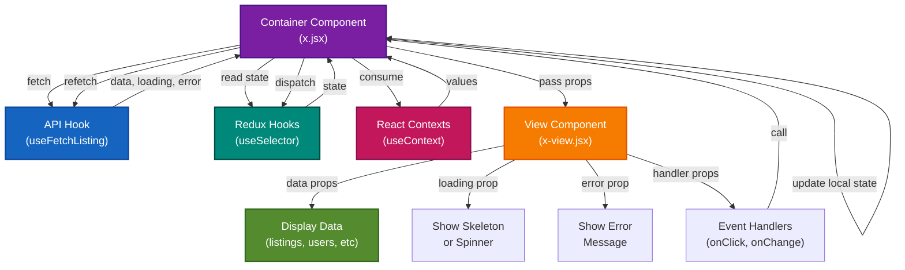

---

## 5. Data Flow & State Management

Three complementary mechanisms manage state across the app:

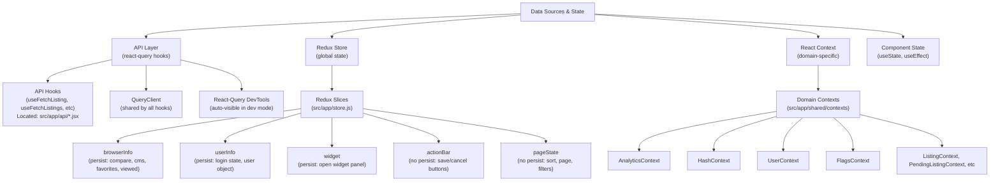

**State Selection Guide:**
- **API data** (react-query): Fresh data from backend, automatic refetching, caching
- **Redux (persisted slices)**: User state, widget lists, favorites—survive reload
- **Redux (unpersisted slices)**: Page state (sort, page, filters)—reset on reload
- **React Context**: Domain-specific, re-exported from `contexts/index.js`
- **Component state**: Form inputs, temporary UI state

---

## 5.1 Complete Component Catalog (Searchable Reference)

All reusable components organized by category with their primary use:

```mermaid
graph TD
    Catalog["Component Catalog<br/>(Quick Reference)"]
    
    Catalog --> PageShell["Page Shell & Layout"]
    Catalog --> Display["Data Display & Visualization"]
    Catalog --> Input["Input & Form Controls"]
    Catalog --> Interaction["Interaction & Navigation"]
    Catalog --> Feedback["Feedback & Messaging"]
    Catalog --> Domain["Domain-Specific Components"]
    
    PageShell --> HS1["ChplPageHeader — Page title + layout"]
    PageShell --> HS2["ChplPageBody — Content area wrapper"]
    PageShell --> HS3["ChplContainer — Responsive max-width"]
    PageShell --> HS4["ChplAppLayout — Main shell (nav + content + widgets)"]
    
    Display --> DS1["ChplTable — Sortable data table"]
    Display --> DS2["ChplCard — Content container (MUI Card)"]
    Display --> DS3["ChplBadge — Status indicator (colored)"]
    Display --> DS4["ChplChip — Tag/pill element"]
    Display --> DS5["ChplList — Vertical list display"]
    Display --> DS6["ChplAvatar — User/profile picture"]
    
    Input --> IS1["ChplTextField — Text input (validation)"]
    Input --> IS2["ChplSelect — Dropdown list"]
    Input --> IS3["ChplAutocomplete — Searchable dropdown"]
    Input --> IS4["ChplCheckbox — Checkbox control"]
    Input --> IS5["ChplRadio — Radio button group"]
    Input --> IS6["ChplSwitch — Toggle on/off"]
    Input --> IS7["DatePicker — Calendar date picker"]
    
    Interaction --> IT1["ChplLink — Internal router link"]
    Interaction --> IT2["ChplButton — Action button"]
    Interaction --> IT3["ChplBreadcrumbs — Navigation trail"]
    Interaction --> IT4["ChplTabs — Tab navigation"]
    Interaction --> IT5["ChplMenu — Dropdown menu"]
    
    Feedback --> FB1["ChplAlert — Dismissible message"]
    Feedback --> FB2["ChplTooltip — Hover help text"]
    Feedback --> FB3["ChplSnackbar — Toast notification"]
    Feedback --> FB4["ChplModal — Dialog popup"]
    
    Domain --> DM1["ChplFilterPanel — Advanced search filters"]
    Domain --> DM2["ChplSortControls — Sort/page/size controls"]
    Domain --> DM3["CompareWidget — Compare products widget"]
    Domain --> DM4["CmsWidget — CMS ID lookup widget"]
    Domain --> DM5["ActionBar — Save/cancel buttons"]
    
    style PageShell fill:#0288d1,color:#fff,stroke:#01579b,stroke-width:2px
    style Display fill:#00897b,color:#fff,stroke:#004d40,stroke-width:2px
    style Input fill:#f57c00,color:#fff,stroke:#e65100,stroke-width:2px
    style Interaction fill:#c2185b,color:#fff,stroke:#880e4f,stroke-width:2px
    style Feedback fill:#6a1b9a,color:#fff,stroke:#4a148c,stroke-width:2px
    style Domain fill:#558b2f,color:#fff,stroke:#33691e,stroke-width:2px
```

### 5.2 Component Usage by Page Area

Where each reusable component is used:

```mermaid
graph TD
    Components["Reusable Components"]
    
    Components --> PageHdr["ChplPageHeader"]
    Components --> PageBdy["ChplPageBody"]
    Components --> Table["ChplTable"]
    Components --> Filter["ChplFilterPanel"]
    Components --> Sort["ChplSortControls"]
    Components --> Button["ChplButton"]
    Components --> Link["ChplLink"]
    Components --> Modal["ChplModal"]
    
    PageHdr -->|used in| Search["Search"]
    PageHdr -->|used in| Listing["Listing"]
    PageHdr -->|used in| Compare["Compare"]
    PageHdr -->|used in| Admin["Administration"]
    PageHdr -->|used in| Reports["Reports"]
    
    Table -->|used in| Search
    Table -->|used in| Reports
    Table -->|used in| Organizations["Organizations"]
    Table -->|used in| Surveillance["Surveillance"]
    
    Filter -->|used in| Search
    Filter -->|used in| Reports
    
    Sort -->|used in| Search
    Sort -->|used in| Reports
    
    Button -->|used in| Search
    Button -->|used in| Listing
    Button -->|used in| Admin
    Button -->|used in| Compare
    
    Link -->|used in| Navigation["Top Nav"]
    Link -->|used in| Breadcrumb["Breadcrumbs"]
    Link -->|used in| Search
    
    Modal -->|used in| Search
    Modal -->|used in| Listing
    Modal -->|used in| Organizations
    
    style PageHdr fill:#0288d1,color:#fff,stroke:#01579b,stroke-width:2px
    style PageBdy fill:#0288d1,color:#fff,stroke:#01579b,stroke-width:2px
    style Table fill:#00897b,color:#fff,stroke:#004d40,stroke-width:2px
    style Filter fill:#f57c00,color:#fff,stroke:#e65100,stroke-width:2px
    style Sort fill:#f57c00,color:#fff,stroke:#e65100,stroke-width:2px
    style Button fill:#558b2f,color:#fff,stroke:#33691e,stroke-width:2px
    style Link fill:#c2185b,color:#fff,stroke:#880e4f,stroke-width:2px
    style Modal fill:#6a1b9a,color:#fff,stroke:#4a148c,stroke-width:2px
```

### 5.3 Component Interaction Chains (Common Patterns)

How components work together in typical scenarios:

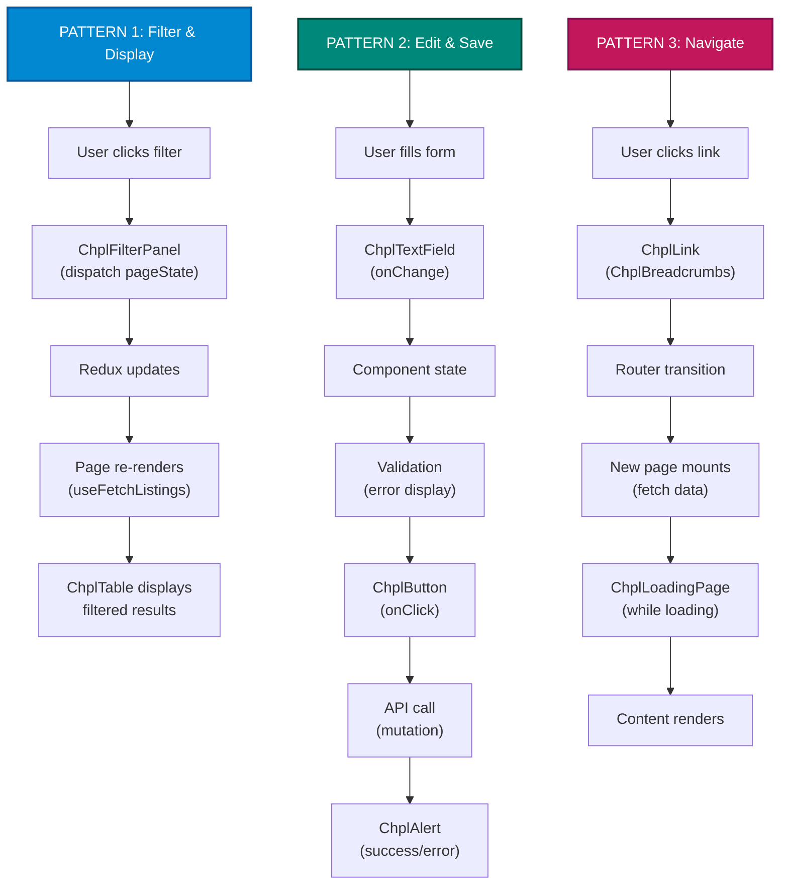

### 5.4 Search Results Page (Detailed Component Tree)

A concrete example showing all components in one complex page:

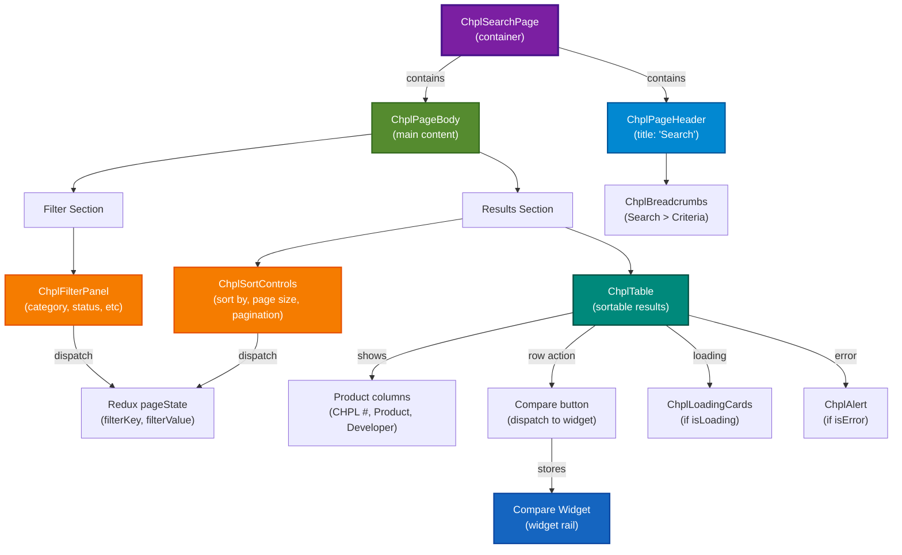

---

## 6. Routing Structure

The app uses `@uirouter/react` with hash-based URLs. Routes are configured in `src/app/router/configure.js`.

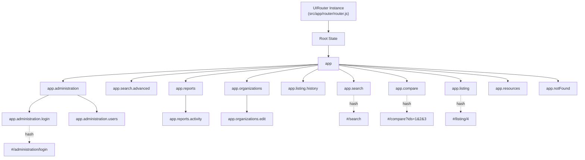

**Key Routing Details:**
- **Hash-based** (e.g., `#/search`) for SPA routing
- **Resolves**: Data fetching before route activation (e.g., listing ID resolves to listing object)
- **Hooks**: Global hooks handle page title, role gates, error handling
- **Navigation**: Use `goToState()` from `services/navigation.service` for imperative nav
- **Role gates**: Certain states require `ROLE_ADMIN`, `ROLE_ONC`, etc. (checked in hooks)

---

## 7. Component Relationships & Dependency Map

This shows how major component groups depend on or relate to each other.

```mermaid
graph LR
    Pages["Page Components<br/>(Search, Compare, Listing)"]
    Shared["Shared Components<br/>(Filter, Tables, Dialogs)"]
    Widgets["Widgets<br/>(Compare, CMS)"]
    API["API Hooks<br/>(useFetchListing, etc)"]
    Redux["Redux Store"]
    Contexts["Contexts<br/>(User, Flags, Analytics)"]
    Services["Services<br/>(Navigation, Sort, etc)"]
    
    Pages -->|fetch data| API
    Pages -->|read/dispatch| Redux
    Pages -->|consume| Contexts
    Pages -->|use| Shared
    
    Shared -->|fetch data| API
    Shared -->|read| Redux
    Shared -->|dispatch| Redux
    
    Widgets -->|read| Redux
    Widgets -->|dispatch| Redux
    
    API -->|query state| Contexts
    
    Services -->|use| Contexts
    Services -->|navigate via| Pages
    
    Contexts -.->|provide| Pages
    Contexts -.->|provide| Shared
```

---

## 8. File Organization Summary

```
src/app/
├── index.js                      # Entry: mounts root to #root
├── app-wrapper.jsx               # Provider stack (Redux, Cookies, MUI, etc.)
├── app-layout.jsx                # Main layout shell (nav, content, widget rail)
├── store.js                      # Redux store & slices config
│
├── router/                       # Routing setup (@uirouter/react)
│   ├── router.js                 # Singleton router instance
│   ├── create-router.js          # Router factory
│   ├── configure.js              # State tree & global hooks
│   ├── states/                   # State definitions by area
│   ├── hooks.js                  # Role gates, page title, error handling
│   └── views/                    # Shell components for route parents
│
├── pages/                        # Feature areas
│   ├── search/                   # Search page & filters
│   ├── compare/                  # Compare products
│   ├── listing/                  # Listing detail view
│   ├── administration/           # Admin features
│   ├── organizations/
│   ├── reports/
│   ├── surveillance/
│   └── ... (other features)
│
├── components/                   # Shared & domain-specific components
│   ├── util/                     # Reusable UI utilities
│   ├── filter/                   # Filter panel
│   ├── action-bar/               # Save/cancel actions
│   ├── action-widget/            # Action buttons widget
│   ├── browser/                  # Browser state widgets
│   ├── compare-widget/           # Compare products widget
│   ├── cms-widget/               # CMS lookup widget
│   ├── login/                    # Login & auth components
│   ├── listing/                  # Listing display components
│   ├── activity/                 # Activity/history components
│   ├── surveillance/             # Surveillance-specific components
│   ├── change-request/           # Change request components
│   └── ... (other domains)
│
├── api/                          # Data fetching (react-query hooks)
│   ├── api-wrapper.jsx           # QueryClient setup
│   ├── listing.jsx               # useFetchListing, useFetchListings
│   ├── organizations.jsx         # useOrganizations, etc.
│   ├── acbs.jsx                  # useFetchAcbs
│   └── ... (other API domains)
│
├── services/                     # Business logic & utilities
│   ├── navigation.service.js     # goToState(), goToUrl()
│   ├── sort.service.js           # compareStrings() for sorting
│   ├── listing.service.js        # listing utilities
│   └── ... (other services)
│
├── shared/                       # Shared utilities & contexts
│   ├── contexts/                 # React Context providers
│   │   ├── user-context.js       # User & auth
│   │   ├── analytics-context.js  # Analytics events
│   │   ├── hash-context.js       # Hash values
│   │   └── ... (other contexts)
│   ├── prop-types/               # PropTypes shapes (Listing, Developer, ACB, etc)
│   └── ... (other shared)
│
├── themes/                       # MUI theming
│   └── theme.js                  # MUI theme config
│
└── navigation/                   # Nav components
    ├── navigation-top.jsx        # Header/top bar
    └── navigation-bottom.jsx     # Footer
```

---

## 9. Data & Props Flow Example: Search Page

To illustrate how data flows through the app, here's a typical feature (the Search page):

```mermaid
graph TD
    User["User Types<br/>in filter panel"]
    
    User -->|onFilterChange| FilterPanel["ChplFilterPanel<br/>(component/filter)"]
    FilterPanel -->|dispatch| PageState["PageState Redux<br/>(store)"]
    PageState -->|triggers| SearchPage["ChplSearchPage<br/>(container)"]
    
    SearchPage -->|usePageState| ReadPageState["Read filter state<br/>from Redux"]
    SearchPage -->|useFetchListings| APIHook["useFetchListings<br/>(api/listing.jsx)"]
    APIHook -->|fetch params| Backend["/rest/listings<br/>(backend API)"]
    Backend -->|listings[]| APIHook
    
    APIHook -->|data, isLoading| SearchPage
    SearchPage -->|listings, isLoading| SearchView["ChplSearchView<br/>(presentational)"]
    SearchView -->|render| ResultsTable["Results Table<br/>(component/util)"]
    ResultsTable -->|user clicks| SearchPage
    
    SearchPage -->|compare listing| CompareWidget["Compare Widget<br/>(dispatch to Redux)"]
    CompareWidget -->|store in| BrowserInfo["browserInfo slice<br/>(persisted)"]
```

---

## 10. Component Categorization

### By Purpose:

| Category | Purpose | Examples |
|----------|---------|----------|
| **Page** | Full-screen routes | SearchPage, ComparePage, ListingDetail |
| **Container** | Data fetching & state | ChplSearchPage, ChplListingDetail |
| **View** | Pure presentation | ChplSearchView, ChplListingView |
| **Widget** | Standalone, reusable UI | CompareWidget, CmsWidget, FilterPanel |
| **Utility** | Generic helpers | Table, Card, Button, Loading Skeleton |
| **Provider** | Context/wrapper | ApiWrapper, UserWrapper, FlagWrapper |

### By Reusability:

| Level | Scope | Examples |
|-------|-------|----------|
| **Global** | Used across many pages | ChplPageHeader, ChplLink, ChplTooltip |
| **Domain** | Specific feature area | ChplFilterPanel (search), ChplChangeRequestForm (change requests) |
| **Local** | Single page or component | SearchSortControls (only in search results) |

---

## 11. Key Patterns & Conventions

### File Naming:
- **Pages**: `name.jsx` (container) + `name-view.jsx` (presentational) + `name-page.jsx` (adds frame)
- **Components**: `name.jsx` (or `name-view.jsx` if presentational)
- **Tests**: `name.test.jsx` (never `.test.js` — would get bundled)
- **Hooks**: Import from `api/domain.jsx` or `shared/contexts/index.js`
- **Services**: `name.service.js` imported from `services/`

### Import Organization:
1. External packages (`react`, `@mui/material`, etc.)
2. Relative imports (`./`, `../`)
3. Bare imports from `src/app` (alphabetized)

### Module Resolution:
- Webpack aliases `src/app/` as root, so imports write as `api/listing`, `components/util`, not relative paths

### CSS & Styling:
- MUI `sx` prop for inline styles (not `styled-components` or CSS files)
- Component-level `const styles = { ... }` objects
- Responsive via `theme.breakpoints.up('md')`, `down('md')`

### Testing:
- Jest + `@testing-library/react` in jsdom
- Mock services, API hooks, and notistack provider
- Loading skeletons have dedicated tests
- Test data via helper functions (not random fixtures)

---

## 12. Cross-Cutting Concerns

Handled by the provider stack or global services:

| Concern | Handler | Location |
|---------|---------|----------|
| **State persistence** | Redux middleware | `store.js` |
| **API requests** | react-query + axios | `api/api-wrapper.jsx` |
| **Authentication** | UserWrapper context | `components/login/` |
| **Feature flags** | FlagWrapper context | `api/flag-wrapper.jsx` |
| **Notifications** | notistack + SnackbarWrapper | `components/util/` |
| **Page title & nav** | Router hooks | `router/hooks.js` |
| **Role-based access** | Router hooks + state guards | `router/hooks.js` |
| **Analytics** | AnalyticsContext | `shared/contexts/` |
| **Theming** | MUI ThemeProvider | `app-wrapper.jsx` |
| **Responsive layout** | MUI breakpoints + media queries | Throughout |

---

## 13. Component Interaction Examples

### Example 1: Filtering Search Results
```
1. User types in ChplFilterPanel
2. FilterPanel dispatches pageState (Redux)
3. Redux update triggers SearchPage re-render
4. SearchPage reads updated filters from Redux
5. useFetchListings hook refetches with new params
6. Results table updates with new listings
7. CompareWidget available on search page
```

### Example 2: Adding to Compare Widget
```
1. User clicks "Compare" on a search result
2. SearchPage dispatches addCompareListing (Redux)
3. browserInfo slice updated & persisted to localStorage
4. CompareWidget in app-layout reads browserInfo
5. Widget re-renders with new listing
6. Persisted state survives page reload
```

### Example 3: Navigation & Role Gates
```
1. User clicks "Surveillance" link
2. Navigation calls goToState('app.surveillance')
3. Router checks role in hook: requires ROLE_ADMIN or ROLE_ONC
4. If role missing: redirected to home or error page
5. If role present: state resolves listing data
6. SurveillancePage renders with resolved data
7. Page title set by router hook
```

---

## 14. Data Flow Layers (Detailed)

```
┌─────────────────────────────────────────────────────┐
│ Browser UI (React Components)                       │
│  ├─ Pages (Search, Listing, Compare, etc)          │
│  ├─ Shared Components (Tables, Modals, Forms)      │
│  └─ Widgets (Compare, CMS, Filter)                 │
└──────────────┬──────────────────────────────────────┘
               │
┌──────────────▼──────────────────────────────────────┐
│ State Management Layer                              │
│  ├─ Redux (browserInfo, userInfo, widget, etc)     │
│  ├─ React Contexts (User, Flags, Analytics)        │
│  ├─ Component State (useState, useEffect)          │
│  └─ react-query cache (API responses)              │
└──────────────┬──────────────────────────────────────┘
               │
┌──────────────▼──────────────────────────────────────┐
│ Data Fetching Layer (react-query Hooks)            │
│  ├─ useFetchListing, useFetchListings              │
│  ├─ useOrganizations, useFetchAcbs                 │
│  └─ Other domain-specific hooks                    │
└──────────────┬──────────────────────────────────────┘
               │
┌──────────────▼──────────────────────────────────────┐
│ HTTP Client (axios)                                 │
│  ├─ Interceptors for auth (axios-jwt)              │
│  ├─ Error handling & retry logic                   │
│  └─ Request/response transformation                │
└──────────────┬──────────────────────────────────────┘
               │
┌──────────────▼──────────────────────────────────────┐
│ Backend API (/rest/*)                              │
│  ├─ /rest/listings - product listings              │
│  ├─ /rest/organizations - ACBs & developers        │
│  ├─ /rest/developer/* - developer details          │
│  └─ Other endpoints (surveillance, reports, etc)   │
└─────────────────────────────────────────────────────┘
```

---

## 15. Migration Notes

### From AngularJS (Legacy):
- AngularJS router is gone; `@uirouter/react` now handles routing
- One-time bootstrapping in `src/app/index.js`
- Some `.mock.js` files and legacy AngularJS references remain but are stale
- All new code is React

### MUI v5 Upgrade (Completed):
- `makeStyles` removed, using `sx` prop instead
- Material-UI `@mui/material` packages in use
- Theme system uses `theme.breakpoints` for responsive design

---

## 16. How to Use This Document

### For Onboarding:
1. Read section 1 (Providers) to understand app initialization
2. Read section 2 (Layout) to see the main shell
3. Read sections 3 & 4 to find where to add new pages/components
4. Use section 5 to decide where to store state

### For Bug Fixing:
1. Identify the page/component from section 3 or 4
2. Trace data flow using section 5 and the Data Flow Example (section 9)
3. Check if state is Redux, Context, or component-local
4. Use Routing (section 6) to understand navigation issues

### For Refactoring:
1. Review Component Relationships (section 7)
2. Check dependencies in File Organization (section 8)
3. Verify patterns match sections 11-13
4. Ensure tests cover both sides of change (per CLAUDE.md)

### For Architecture Decisions:
1. Cross-Cutting Concerns (section 12) shows what's available
2. Component Categorization (section 10) guides naming & organization
3. Data Flow Layers (section 14) shows where to add new concerns

---

## 17. Major Page Areas — Detailed Component Trees

### 17.1 Search Page Area (src/app/pages/search/)

The most complex page with filtering, sorting, and product comparison:

```mermaid
graph TD
    SearchArea["Search Area<br/>(src/app/pages/search/)"]
    
    SearchArea --> SearchPage["ChplSearchPage<br/>(container)"]
    SearchArea --> SearchView["ChplSearchView<br/>(presentational)"]
    SearchArea --> RWT["Real World Testing<br/>(sub-feature)"]
    
    SearchPage -->|fetch| Listings["useFetchListings<br/>(with filters)"]
    SearchPage -->|state| PageState["usePageState<br/>(filters, sort, page)"]
    SearchPage -->|context| UserCtx["useUserContext<br/>(role for visibility)"]
    
    SearchPage -->|render| SearchView
    SearchView -->|contains| FilterPanel["ChplFilterPanel<br/>(left sidebar)"]
    SearchView -->|contains| ResultsArea["Results Area"]
    
    FilterPanel -->|components| FilterCats["Filter Categories<br/>(CHPL Product, Status, etc)"]
    FilterCats -->|actions| DispatchFilter["dispatch pageState"]
    
    ResultsArea -->|header| SortCtrl["ChplSortControls<br/>(sort, pagination)"]
    ResultsArea -->|table| Table["ChplTable<br/>(products list)"]
    ResultsArea -->|actions| CompareBtn["Compare Button<br/>(add to widget)"]
    
    RWT -->|page| RWTPage["Real World Testing View<br/>(similar structure)"]
    RWTPage -->|data| RWTListings["useFetchListings<br/>(RWT data)"]
    
    style SearchArea fill:#1565c0,color:#fff,stroke:#0d47a1,stroke-width:3px
    style FilterPanel fill:#f57c00,color:#fff,stroke:#e65100,stroke-width:2px
    style Table fill:#00897b,color:#fff,stroke:#004d40,stroke-width:2px
    style SortCtrl fill:#f57c00,color:#fff,stroke:#e65100,stroke-width:2px
```

### 17.2 Listing Detail Page (src/app/pages/listing/)

Displays comprehensive product information with tabs:

```mermaid
graph TD
    ListingArea["Listing Area<br/>(src/app/pages/listing/)"]
    
    ListingArea --> ListingPage["ChplListingDetail<br/>(container)"]
    ListingArea --> ListingView["ChplListingDetailView<br/>(presentational)"]
    ListingArea --> Tabs["Tabs Sub-Pages"]
    
    ListingPage -->|fetch| Listing["useFetchListing<br/>(by ID)"]
    ListingPage -->|fetch| ACB["useFetchAcb<br/>(certifying body)"]
    ListingPage -->|fetch| Developer["useFetchDeveloper<br/>(vendor)"]
    
    ListingView -->|header| Header["Listing Header<br/>(title, status, ACB)"]
    ListingView -->|tabs| TabNav["ChplTabs<br/>(History, Activity, etc)"]
    ListingView -->|content| TabContent["Tab Content Area"]
    
    Tabs -->|History Tab| HistoryPage["History Tab<br/>(show changes over time)"]
    Tabs -->|Activity Tab| ActivityPage["Activity Tab<br/>(recent events)"]
    Tabs -->|Certification Tab| CertPage["Certification Tab<br/>(cert details)"]
    
    HistoryPage -->|table| HistoryTable["History Table<br/>(before/after values)"]
    ActivityPage -->|log| ActivityLog["Activity Log<br/>(timestamped events)"]
    
    Header -->|actions| EditBtn["Edit Button<br/>(if authorized)"]
    EditBtn -->|modal| EditForm["Edit Form<br/>(ChplModal)"]
    EditForm -->|components| FormInputs["ChplTextField<br/>ChplSelect<br/>ChplCheckbox"]
    
    style ListingArea fill:#7b1fa2,color:#fff,stroke:#4a148c,stroke-width:3px
    style TabNav fill:#f57c00,color:#fff,stroke:#e65100,stroke-width:2px
    style HistoryTable fill:#00897b,color:#fff,stroke:#004d40,stroke-width:2px
    style EditForm fill:#c2185b,color:#fff,stroke:#880e4f,stroke-width:2px
```

### 17.3 Administration Area (src/app/pages/administration/)

User & system management with forms and approvals:

```mermaid
graph TD
    AdminArea["Administration Area<br/>(src/app/pages/administration/)"]
    
    AdminArea --> Login["Login Page<br/>(public)"]
    AdminArea --> Users["Users Management<br/>(admin only)"]
    AdminArea --> Reports["Admin Reports<br/>(admin only)"]
    AdminArea --> Invites["Invite Users<br/>(admin only)"]
    
    Login -->|form| LoginForm["ChplLoginForm<br/>(username/password)"]
    LoginForm -->|post| Auth["Authentication<br/>(backend)"]
    Auth -->|redirect| Dashboard["Admin Dashboard<br/>(if authorized)"]
    
    Users -->|page| UsersList["Users List Page<br/>(table of all users)"]
    UsersList -->|table| UsersTable["ChplTable<br/>(users + roles)"]
    UsersTable -->|action| EditUser["Edit User<br/>(ChplModal)"]
    
    EditUser -->|form| UserForm["User Form<br/>(email, role, status)"]
    UserForm -->|inputs| FormCtrl["ChplTextField<br/>ChplSelect"]
    UserForm -->|save| Update["Dispatch userUpdate<br/>(API call)"]
    
    Invites -->|form| InviteForm["Invite Form<br/>(email, role)"]
    InviteForm -->|components| InviteInputs["ChplTextField<br/>ChplSelect<br/>ChplButton"]
    
    Reports -->|list| ReportsList["Reports List"]
    ReportsList -->|chart| Charts["Analytics Charts<br/>(user activity, etc)"]
    
    style AdminArea fill:#c2185b,color:#fff,stroke:#880e4f,stroke-width:3px
    style LoginForm fill:#0288d1,color:#fff,stroke:#01579b,stroke-width:2px
    style UsersTable fill:#00897b,color:#fff,stroke:#004d40,stroke-width:2px
    style UserForm fill:#f57c00,color:#fff,stroke:#e65100,stroke-width:2px
```

### 17.4 Reports & Analytics Area (src/app/pages/reports/)

Data aggregation, filters, downloads:

```mermaid
graph TD
    ReportsArea["Reports Area<br/>(src/app/pages/reports/)"]
    
    ReportsArea --> Activity["Activity Reports<br/>(what changed)"]
    ReportsArea --> Download["Download Listings<br/>(export data)"]
    ReportsArea --> RealWorldTesting["Real World Testing<br/>(survey results)"]
    ReportsArea --> Analytics["Analytics Charts"]
    
    Activity -->|page| ActivityPage["Activity Report Page"]
    ActivityPage -->|filter| ActivityFilter["ChplFilterPanel<br/>(date, type, etc)"]
    ActivityPage -->|table| ActivityTable["Activity Table<br/>(with sorting)"]
    ActivityPage -->|export| Download1["Download CSV<br/>(ChplButton)"]
    
    Download -->|page| DownloadPage["Download Listings Page"]
    DownloadPage -->|filter| DownloadFilter["ChplFilterPanel<br/>(product status, etc)"]
    DownloadPage -->|progress| JobStatus["Job Status<br/>(if async)"]
    DownloadPage -->|download| FileLink["File Download Link<br/>(CSV/JSON)"]
    
    RealWorldTesting -->|page| RWTPage["RWT Report Page<br/>(survey results view)"]
    RWTPage -->|table| RWTTable["Results Table<br/>(product + score)"]
    RWTPage -->|sort| SortCtrl["ChplSortControls"]
    
    Analytics -->|page| AnalyticsPage["Analytics Page"]
    AnalyticsPage -->|charts| Charts["Chart Components<br/>(Recharts)"]
    Charts -->|types| BarChart["Bar Charts<br/>(product count)"]
    Charts -->|types| LineChart["Line Charts<br/>(trends)"]
    Charts -->|types| PieChart["Pie Charts<br/>(distribution)"]
    
    style ReportsArea fill:#6a1b9a,color:#fff,stroke:#4a148c,stroke-width:3px
    style ActivityTable fill:#00897b,color:#fff,stroke:#004d40,stroke-width:2px
    style DownloadFilter fill:#f57c00,color:#fff,stroke:#e65100,stroke-width:2px
    style Charts fill:#d32f2f,color:#fff,stroke:#b71c1c,stroke-width:2px
```

### 17.5 Organizations Area (src/app/pages/organizations/)

ACB & Developer management:

```mermaid
graph TD
    OrgArea["Organizations Area<br/>(src/app/pages/organizations/)"]
    
    OrgArea --> ACBList["ACB (Certifying Body) List"]
    OrgArea --> ACBDetail["ACB Detail Page"]
    OrgArea --> DevList["Developer List"]
    OrgArea --> DevDetail["Developer Detail Page"]
    
    ACBList -->|page| ACBListPage["Organizations List Page"]
    ACBListPage -->|filter| Filter["ChplFilterPanel<br/>(status, state, etc)"]
    ACBListPage -->|table| OrgTable["ChplTable<br/>(ACBs)"]
    OrgTable -->|row click| ACBDetail
    
    ACBDetail -->|fetch| FetchACB["useFetchAcb<br/>(by ID)"]
    ACBDetail -->|display| DetailView["ACB Detail View"]
    DetailView -->|header| DetailHeader["Org Header<br/>(name, status)"]
    DetailView -->|info| DetailInfo["Org Info<br/>(address, contact)"]
    DetailView -->|products| ProductList["Products Under ACB<br/>(ChplTable)"]
    DetailView -->|actions| EditBtn["Edit Button<br/>(if authorized)"]
    
    EditBtn -->|form| EditForm["ACB Edit Form<br/>(ChplModal)"]
    EditForm -->|inputs| FormInputs["ChplTextField<br/>ChplSelect<br/>ChplCheckbox"]
    
    DevList -->|similar| SimilarACB["(similar structure<br/>to ACB list)"]
    
    style OrgArea fill:#0288d1,color:#fff,stroke:#01579b,stroke-width:3px
    style OrgTable fill:#00897b,color:#fff,stroke:#004d40,stroke-width:2px
    style DetailHeader fill:#f57c00,color:#fff,stroke:#e65100,stroke-width:2px
    style EditForm fill:#c2185b,color:#fff,stroke:#880e4f,stroke-width:2px
```

### 17.6 Surveillance & Complaints Area (src/app/pages/surveillance/)

Track issues, non-conformities, complaints:

```mermaid
graph TD
    SurvArea["Surveillance Area<br/>(src/app/pages/surveillance/)"]
    
    SurvArea --> Complaints["Complaints<br/>(file & view)"]
    SurvArea --> NonConf["Non-Conformities<br/>(track issues)"]
    SurvArea --> DirectReviews["Direct Reviews<br/>(audit findings)"]
    
    Complaints -->|list| ComplaintsList["Complaints List Page"]
    ComplaintsList -->|table| ComplaintsTable["ChplTable<br/>(complaints)"]
    ComplaintsTable -->|row click| DetailPage["Complaint Detail Page"]
    
    DetailPage -->|display| DetailView["Complaint Details<br/>(filed by, date, status)"]
    DetailView -->|status| Status["Status Badge<br/>(open, closed, etc)"]
    DetailView -->|comments| Comments["Comments Section<br/>(activity log)"]
    
    ComplaintsList -->|filter| Filter["ChplFilterPanel<br/>(status, ACB, date)"]
    ComplaintsList -->|action| FileBtn["File New Button"]
    FileBtn -->|form| FileForm["File Complaint Form<br/>(ChplModal)"]
    FileForm -->|inputs| FormInputs["ChplTextField<br/>ChplTextArea<br/>ChplSelect"]
    
    NonConf -->|similar| SimilarNonConf["(similar structure)"]
    
    DirectReviews -->|list| DirectList["Direct Reviews List"]
    DirectList -->|table| DirectTable["ChplTable<br/>(reviews + findings)"]
    
    style SurvArea fill:#c2185b,color:#fff,stroke:#880e4f,stroke-width:3px
    style ComplaintsTable fill:#00897b,color:#fff,stroke:#004d40,stroke-width:2px
    style DetailView fill:#0288d1,color:#fff,stroke:#01579b,stroke-width:2px
    style FileForm fill:#f57c00,color:#fff,stroke:#e65100,stroke-width:2px
```

---

## 18. Component Performance & Bundle Impact

```mermaid
graph TD
    Bundle["Bundle Optimization"]
    
    Bundle --> CodeSplit["Code Splitting<br/>(lazy loaded pages)"]
    Bundle --> TreeShake["Tree Shaking<br/>(unused code removed)"]
    Bundle --> Minify["Minification<br/>(production build)"]
    Bundle --> LargeComp["Large Components<br/>(impact assessment)"]
    
    CodeSplit -->|impact| Pages["Page components<br/>are route-lazy loaded"]
    
    TreeShake -->|impact| Utilities["Unused util components<br/>don't increase bundle"]
    
    Minify -->|impact| Prod["Production build<br/>is 60-70% smaller"]
    
    LargeComp -->|check| ChplTable["ChplTable<br/>(sorting, pagination logic)"]
    LargeComp -->|check| FilterPanel["ChplFilterPanel<br/>(complex filter logic)"]
    LargeComp -->|check| Modals["Modal components<br/>(rarely used, consider lazy)"]
    
    style CodeSplit fill:#00897b,color:#fff,stroke:#004d40,stroke-width:2px
    style TreeShake fill:#00897b,color:#fff,stroke:#004d40,stroke-width:2px
    style Minify fill:#0288d1,color:#fff,stroke:#01579b,stroke-width:2px
    style LargeComp fill:#f57c00,color:#fff,stroke:#e65100,stroke-width:2px
```

---

## 19. Quick Reference: Component by Use Case

### "I need to show a loading state"
→ Use `ChplLoadingPage`, `ChplLoadingCards`, or `ChplSkeleton` (not a spinner)

### "I need to let the user filter data"
→ Use `ChplFilterPanel` (or build on top of it)

### "I need to display a list of items"
→ Use `ChplTable` with sorting support

### "I need a form for user input"
→ Build with `ChplTextField`, `ChplSelect`, `ChplCheckbox`, etc.
→ Wrap in `ChplModal` or use `ChplPageBody`

### "I need to store user's choice across sessions"
→ Use Redux persisted slice (browserInfo, userInfo)

### "I need to store temporary filter state"
→ Use Redux pageState (not persisted)

### "I need to fetch data from the API"
→ Use react-query hook from `api/*.jsx`
→ Import with `useFetch*` pattern

### "I need to show a success/error message"
→ Use `useSnackbar()` from notistack or `ChplAlert`

### "I need to navigate to another page"
→ Use `ChplLink` or `goToState()` from navigation.service

### "I need a reusable component for my feature"
→ Check `components/util/` first
→ Check domain-specific folder (e.g., `components/listing/`)
→ If not found, create in your feature folder

---

## 20. Future Improvements

As the codebase evolves, keep this document updated:
- [ ] Add subsection for each major page area with its own micro-diagram
- [ ] Link specific files from `pages/` and `components/` directories
- [ ] Add performance notes (lazy loading, code splitting, bundle impact)
- [ ] Include external API documentation links
- [ ] Add testing pyramid & test examples per feature
- [ ] Document any new providers or cross-cutting concerns
- [ ] Include screenshots of key flows for visual learners

---

**Last Updated**: 2026-11-16  
**Maintained By**: Development Team  
**Related Files**: `CLAUDE.md`, `README.md`, `jest.config.js`, `webpack.config.js`
